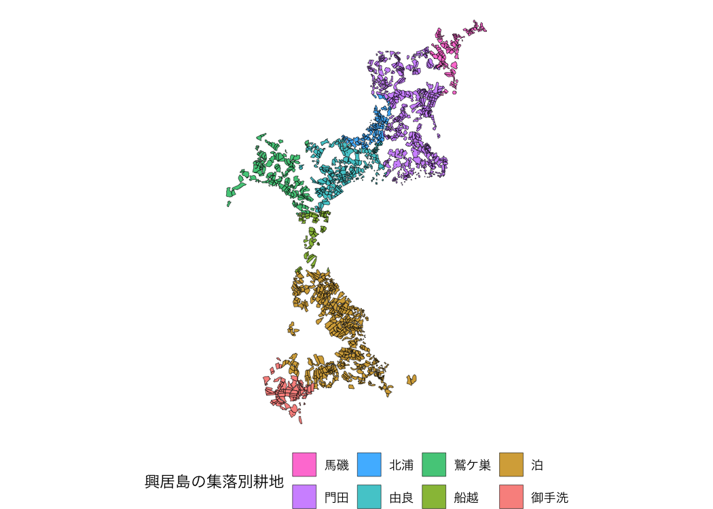
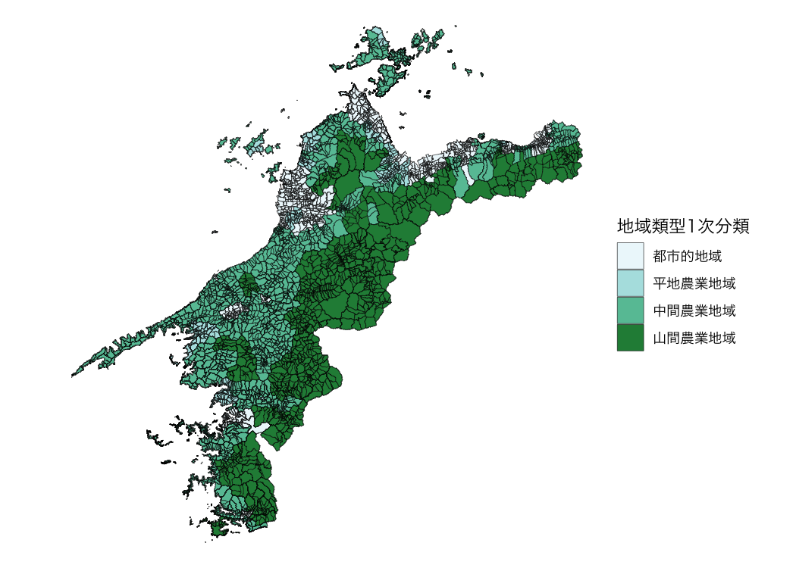

# fude

The fude package provides utilities to facilitate the handling of the
Fude Polygon data downloadable from the Ministry of Agriculture,
Forestry and Fisheries (MAFF) website. The word “fude” is a Japanese
counter suffix used to denote land parcels.

## Obtain data

Fude Polygon data can now be downloaded from two different MAFF websites
(both available only in Japanese):

1.  **GeoJSON format**:\
    <https://open.fude.maff.go.jp>

2.  **FlatGeobuf format**:\
    <https://www.maff.go.jp/j/tokei/census/shuraku_data/2025/mb/>

## Install the package

You can install the released version of fude from CRAN with:

``` r

install.packages("fude")
```

Or the development version from GitHub with:

``` r

pak::pak("takeshinishimura/fude")
```

## Usage

### Read Fude Polygon data

There are two ways to load Fude Polygon data, depending on how the data
was obtained:

1.  **From a locally saved ZIP file**:\
    This method works for both GeoJSON (from Obtaining Data \#1) and
    FlatGeobuf (from Obtaining Data \#2) formats. You can load a ZIP
    file saved on your computer without unzipping it.

``` r

library(fude)
d <- read_fude("~/2022_38.zip")
```

2.  **By specifying a prefecture name or code**:\
    This method is available only for FlatGeobuf data (from Obtaining
    Data \#2). Provide the name of a prefecture (e.g., “愛媛”) or its
    corresponding prefecture code (e.g., “38”), and the required
    FlatGeobuf format ZIP file will be automatically downloaded and
    loaded.

``` r

d2 <- read_fude(pref = "愛媛")
# d2 <- read_fude("~/MB0001_2026_2025_38.zip.001")
```

### Merging ZIP Files

Since the 2026 release, Fude Polygon data provided by the MAFF have been
distributed as split ZIP archives (e.g., .zip.001, .zip.002, and
.zip.003).

After downloading all parts of the archive, you can merge them into a
single ZIP file using the following function:

``` r

merge_split_zip("~/MB0001_2026_2025_38.zip.001", output_dir = "~")
#> Merging: MB0001_2026_2025_38.zip.001
#> Merging: MB0001_2026_2025_38.zip.002
#> Merging: MB0001_2026_2025_38.zip.003
#> Merging: MB0001_2026_2025_38.zip.004
#> Merging: MB0001_2026_2025_38.zip.005
#> Merge complete: ~/MB0001_2026_2025_38.zip
```

### Get agricultural community boundary data

Download the agricultural community boundary data, which corresponds to
the Fude Polygon data, from the MAFF website:
<https://www.maff.go.jp/j/tokei/census/shuraku_data/2025/ma/> (available
only in Japanese).

``` r

b <- get_boundary(d)
```

### Combine Fude Polygons with agricultural community boundaries

You can easily combine Fude Polygons with agricultural community
boundaries to create enriched spatial analyses or maps.

``` r

library(ggplot2)

db <- combine_fude(d2, b, city = "松山市", rcom = "由良|北浦|鷲ケ巣|門田|馬磯|泊|御手洗|船越")

ggplot() +
  geom_sf(data = db$fude, aes(fill = rcom_name), alpha = .8) +
  guides(fill = guide_legend(reverse = TRUE, title = "興居島の集落別耕地")) +
  theme_void() +
  theme(legend.position = "bottom") +
  theme(text = element_text(family = "Hiragino Sans"))
```



**出典**：農林水産省「筆ポリゴンデータ（2026年度公開）」および「農業集落境界データ（2025年度）」を加工して作成。

Data enables extraction based on municipality names, former municipality
names, and agricultural community names.

**Note:** This feature is available only for data obtained from
FlatGeobuf (Obtaining Data \#2).

``` r

extract_fude(d2, city = "松山市", kcity = "興居島")
#> Simple feature collection with 1719 features and 6 fields
#> Geometry type: MULTIPOLYGON
#> Dimension:     XY
#> Bounding box:  xmin: 132.6373 ymin: 33.87055 xmax: 132.6991 ymax: 33.92544
#> Geodetic CRS:  JGD2000
#> # A tibble: 1,719 × 7
#>    polygon_uuid                   land_type issue_year point_lng point_lat key  
#>  * <chr>                              <dbl>      <dbl>     <dbl>     <dbl> <chr>
#>  1 766414a4-b6a2-4e94-ad80-7a4c9…       200       2026      133.      33.9 3820…
#>  2 78e4815b-f4c1-46e4-bd73-fb335…       200       2026      133.      33.9 3820…
#>  3 f33d121f-23a2-48a5-9ba1-0b181…       200       2026      133.      33.9 3820…
#>  4 f09e31b1-6f08-49e1-9a87-e5fa1…       200       2026      133.      33.9 3820…
#>  5 73fe9c01-ca49-4e03-ad11-5c869…       200       2026      133.      33.9 3820…
#>  6 b67f6e44-1ed6-4e2a-b1ca-80fbe…       200       2026      133.      33.9 3820…
#>  7 dc3e607a-d3c7-46e5-a643-63281…       200       2026      133.      33.9 3820…
#>  8 4dfd0831-76ad-4404-abc2-53489…       200       2026      133.      33.9 3820…
#>  9 fcf27bd2-b2eb-47a4-86be-53d75…       200       2026      133.      33.9 3820…
#> 10 051fced3-b768-4d07-91d5-29e2b…       200       2026      133.      33.9 3820…
#> # ℹ 1,709 more rows
#> # ℹ 1 more variable: geometry <MULTIPOLYGON [°]>
```

### Explore Fude Polygon data

You can explore Fude Polygon data interactively.

``` r

library(shiny)

s <- shiny_fude(db, rcom = TRUE)
# shinyApp(ui = s$ui, server = s$server)
```

### Read data from the MAFF database

You can read data from the MAFF database
([地域の農業を見て・知って・活かすDB](https://www.maff.go.jp/j/tokei/census/shuraku_data/)).

``` r

library(dplyr)

b1 <- get_boundary(d2, path = "~", boundary_type = 1, quiet = TRUE)
# b2 <- get_boundary(d2, path = "~", boundary_type = 2, quiet = TRUE)
# b3 <- get_boundary(d2, path = "~", boundary_type = 3, quiet = TRUE)

m1 <- b1 |>
  read_ikasudb("~/IA0001_2023_2020_38.xlsx") |>
  mutate(
    地域類型1次分類 = factor(
      地域類型1次分類,
      levels = 1:4,
      labels = c("都市的地域", "平地農業地域", "中間農業地域", "山間農業地域")
    )
  )

ggplot() +
  geom_sf(data = m1, aes(fill = 地域類型1次分類)) +
  scale_fill_brewer(palette = "BuGn", na.translate = FALSE) +
  theme_void() +
  theme(text = element_text(family = "Hiragino Sans"))
```



**資料**：農林水産省「農業集落境界データ（2025年度）」を加工して作成。
